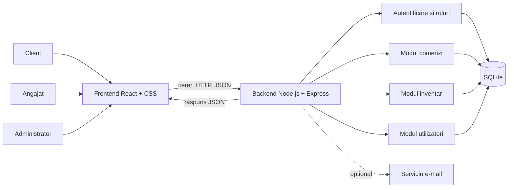

# Arhitectura aplicației Repair4U

## 1. Diagrama arhitecturii

Linia punctată indică o componentă opțională (notificările prin e-mail).

## 2. Componentele sistemului

### 2.1 Frontend (React + CSS)
- Afișează ecranele aplicației: login, dashboard angajat (lista comenzilor), pagina clientului (verificarea statusului după ID-ul comenzii), pagina administratorului (stoc piese și utilizatori).
- Gestionează navigarea între pagini (React Router).
- Trimite cereri către API și afișează răspunsurile.
- Ascunde elementele de interfață la care utilizatorul nu are drept, în funcție de rol.
- Nu accesează niciodată baza de date direct.

### 2.2 Backend (Node.js + Express)
- Primește cererile de la frontend și le validează.
- Verifică identitatea utilizatorului (token JWT) și rolul acestuia, înainte de fiecare operație protejată.
- Conține logica aplicației, de exemplu: crearea unei comenzi, schimbarea statusului, scăderea stocului unei piese, semnalarea pieselor sub limita de alertă.
- Este împărțit în module: autentificare, comenzi, inventar, utilizatori.
- Citește și scrie în baza de date și returnează răspunsul în format JSON.

### 2.3 Baza de date (SQLite)
- Bază de date relațională, stocată într-un singur fișier, ușor de configurat.
- Tabele principale: `Users`, `Orders`, `Inventory`.
- Parolele se stochează criptat (hash), nu în clar.
- Detaliile despre tabele și relații se găsesc în [Modelul de date](datamodel.md).

### 2.4 Serviciu de e-mail (opțional)
- Trimite un e-mail clientului când se schimbă statusul reparației.
- Va fi implementat doar dacă permite timpul, după funcționalitățile obligatorii.

## 3. Comunicarea dintre componente

| De la | Către | Protocol | Format | Scop |
| :--- | :--- | :--- | :--- | :--- |
| Browser | Frontend | HTTP | HTML/JS/CSS | Încărcarea aplicației |
| Frontend | Backend | HTTP (REST) | JSON | Cereri către API |
| Backend | SQLite | Interogări SQL | Date relaționale | Citire și scriere date |
| Backend | Serviciu e-mail | SMTP | E-mail | Notificări (opțional) |

Autentificarea funcționează astfel:
1. Utilizatorul trimite email și parolă la `POST /api/auth/login`.
2. Backend-ul verifică datele și returnează un token JWT care conține id-ul și rolul utilizatorului.
3. Frontend-ul trimite tokenul în antetul `Authorization` la fiecare cerere următoare.
4. Backend-ul verifică tokenul și rolul înainte de a executa operația. Dacă rolul nu are dreptul, returnează `403 Forbidden`.
